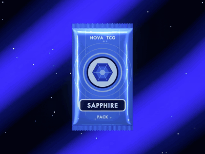

# Pack Animation (Blender + Python)

A procedural 3D booster-pack teaser, built entirely from code and rendered headless with Blender. I made this style of looping pack animation for NFT collection listings on Magic Eden.



[Full 15-second render (MP4)](docs/pack_demo.mp4)

## What it does

- **`design.py`** draws the flat front artwork of the pack (sapphire gradient, circuit rings, gem emblem, label and sparkles) and saves it as `design.png`.
- **`pack.py`** builds the 3D pack from scratch:
  - foil body with puff, crimped top and bottom bands with serrated edges, and subtle wrinkles
  - artwork mapped onto the front
  - virtual softboxes for foil reflections, moving diagonal light beams, sparkle particles and glow
  - a gentle sway that loops seamlessly (150 frames, 5 seconds at 30 fps)

No 3D modelling by hand: change a few numbers or swap `design.png` for your own artwork to make a new pack.

## Run it

Requires [Blender](https://www.blender.org/download/) 4.x or 5.x.

```bash
# 1. Draw the artwork (optional: pick any font)
PACK_FONT=/path/to/font.ttf blender -b --python design.py

# 2. Quick check: render 3 frames only
blender -b --python pack.py -- test

# 3. Full render to frames/
blender -b --python pack.py
```

On macOS, `blender` is `/Applications/Blender.app/Contents/MacOS/Blender`.

Turn the frames into a video:

```bash
ffmpeg -framerate 30 -i frames/f_%04d.png -c:v libx264 -pix_fmt yuv420p pack.mp4
```

## Tweak it

| Setting | File | What it changes |
|---|---|---|
| `DESIGN` | `pack.py` | Artwork image on the front |
| `FRAMES`, `RES` | `pack.py` | Length and resolution |
| `W`, `BODY`, `CRIMP`, `PUFF` | `pack.py` | Pack shape |
| `PACK_FONT` | environment | Font used by `design.py` |

## How this was built

I directed the look (pack shape, lighting, motion and loop) and tested each render. [Claude Code](https://claude.com/claude-code) wrote most of the Python.

## License

MIT
